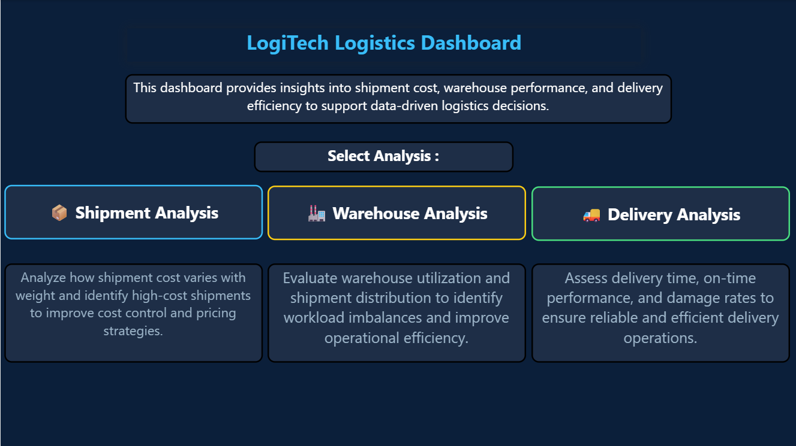
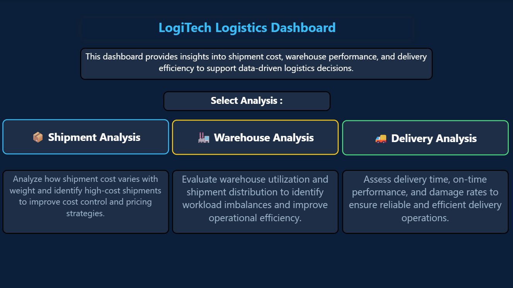
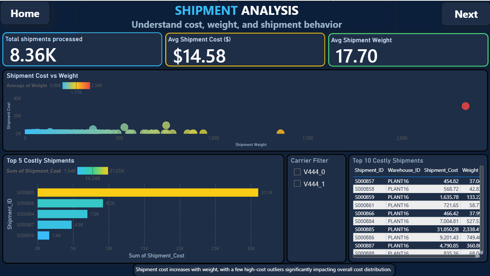
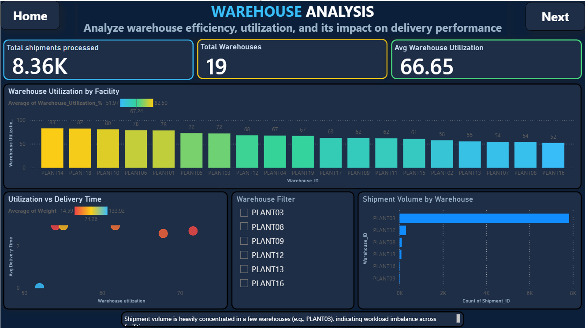

# Logistics Analytics & Delay Prediction

**Author:** Mohammed Athar Ansari

An end-to-end logistics analytics project combining data cleaning, exploratory data analysis, SQL analysis, statistical validation, feature engineering, machine learning, and a multi-page Power BI dashboard.

## Project Overview

This project explores shipment, inventory, and warehouse data to understand delivery performance, examine patterns associated with delayed shipments, and investigate shipment-cost drivers. The workflow uses Python and SQL for analysis, scikit-learn for predictive modeling, and Power BI for interactive reporting.

## Objectives

- Understand the shipment, inventory, and warehouse datasets.
- Assess data quality and explore distributions, relationships, and operational patterns.
- Use SQL queries, aggregations, and joins to summarize logistics data.
- Apply statistical tests to investigate selected relationships.
- Engineer and prepare features for machine-learning workflows.
- Train and evaluate a delivery-delay classification model and a shipment-cost regression model.
- Present logistics KPIs and trends through an interactive Power BI report.

## Tools and Technologies

- **Python:** pandas, NumPy
- **Visualization:** Matplotlib, Seaborn
- **SQL:** SQLite
- **Statistics:** probability analysis, Chi-square test, independent-samples t-test
- **Machine learning:** scikit-learn, Logistic Regression, Linear Regression, StandardScaler, train/test split
- **Business intelligence:** Microsoft Power BI
- **Development environment:** Jupyter Notebook

## Project Structure

```text
Logistics_Analysis_&_Delay_Prediction/
├── data/
│   ├── raw/
│   ├── processed/
│   └── logistics.db
├── notebooks/
│   ├── 1_Data_Understanding_and_EDA.ipynb
│   ├── 2_SQL_Based_Data_Analysis.ipynb
│   ├── 3_Statistical_Validation.ipynb
│   ├── 4_Feature_Engineering.ipynb
│   ├── 5_Machine_Learning_Modeling.ipynb
│   └── 6_Model_Evaluation.ipynb
├── dashboard/
│   ├── Screenshots/
│   └── logistics_dashboard.pbix
├── presentation/
│   └── LogiTech_Presentation.pptx
└── README.md
```

## Project Workflow

Run the notebooks in the following order. Later stages use processed files generated by earlier notebooks.

| Order | Notebook | Purpose |
|---|---|---|
| 1 | `1_Data_Understanding_and_EDA.ipynb` | Review the datasets, examine missing values and data quality, perform descriptive and exploratory analysis, and record business questions and insights. Exports cleaned CSV files to `data/processed/`. |
| 2 | `2_SQL_Based_Data_Analysis.ipynb` | Connect to SQLite, load cleaned data into SQL tables, run queries and aggregations, join data, and extract insights. |
| 3 | `3_Statistical_Validation.ipynb` | Perform probability analysis, a Chi-square test, and an independent-samples t-test. |
| 4 | `4_Feature_Engineering.ipynb` | Create and transform features, select features, scale numeric columns, and save `model_ready_dataset.csv`. |
| 5 | `5_Machine_Learning_Modeling.ipynb` | Train a Logistic Regression classifier for delivery-delay prediction and a Linear Regression model for shipment-cost prediction. Save predictions to `final_model_results.csv`. |
| 6 | `6_Model_Evaluation.ipynb` | Evaluate the saved delay-classification predictions and shipment-cost regression results. |

## Power BI Dashboard

The Power BI report is a **single `.pbix` file with multiple report pages**, rather than separate dashboard files.

### Home

The landing page introduces the report and provides navigation to the shipment, warehouse, and delivery analyses.

### Shipment Analysis

Includes shipment volume, average shipment cost, average shipment weight, a cost-versus-weight visual, costly-shipment rankings, and a carrier filter.

### Warehouse Analysis

Includes shipment volume, number of warehouses, average warehouse utilization, utilization by facility, utilization versus delivery time, shipment volume by warehouse, and a warehouse filter.

### Delivery Analysis

Includes average delivery time, on-time delivery percentage, damage rate, delivery-time distribution, delivery performance, shipment damage breakdown, and a delivery-mode filter.

### Dashboard Preview

The screenshots below show the report's main pages. The full interactive report is available in [`dashboard/logistics_dashboard.pbix`](dashboard/logistics_dashboard.pbix) and can be opened with Power BI Desktop.

#### Home


#### Shipment Analysis


#### Warehouse Analysis


#### Delivery Analysis


> **Screenshot setup:** Create a `screenshots` folder inside `dashboard/` and save the four screenshots using the exact filenames shown above. If you prefer to include only one image, keep the Home screenshot and remove the other three image entries.

## Verified Model Results

The saved outputs in the supplied notebooks report:

- **Delivery-delay classification accuracy:** approximately **95.44%** on the test set of 1,843 rows.
- **Recall for delayed shipments (class `1`):** **0.05**. The evaluation set contains 87 examples of class `1`, compared with 1,756 examples of class `0`. The high overall accuracy therefore does not mean the model identifies delayed shipments well.
- **Shipment-cost regression \(R^2\):** **-46.0877**, indicating poor performance by the current regression model on the evaluation data.

These results are reported transparently as the current notebook outputs; the cost model needs further investigation before it can be presented as a useful predictor.

## Setup and Reproduction

### 1. Prepare the project files

Keep the `data/`, `notebooks/`, `dashboard/`, and `presentation/` folders together as shown in the project structure. Ensure the source files are present in `data/raw/` before running the first notebook.

### 2. Create a Python environment

Python 3.10 or a compatible version is recommended.

```bash
python -m venv .venv
```

Activate it on Windows:

```bash
.venv\Scripts\activate
```

Activate it on macOS/Linux:

```bash
source .venv/bin/activate
```

### 3. Install dependencies

```bash
pip install pandas numpy matplotlib seaborn scikit-learn jupyter
```

SQLite support is provided by Python's standard-library `sqlite3` module, so a separate SQLite Python package is not normally required.

### 4. Start Jupyter

From the project root:

```bash
jupyter notebook
```

Open the `notebooks/` directory and run the six notebooks in the order listed above.

### 5. Check generated processed files

The notebooks expect or generate the following files under `data/processed/`:

- `shipment_cleaned.csv`
- `inventory_cleaned.csv`
- `warehouse_cleaned.csv`
- `model_ready_dataset.csv`
- `final_model_results.csv`

If a later notebook reports that a file is missing, confirm that earlier notebooks completed successfully and that the processed CSV files are in the expected directory.

### 6. Open the Power BI report

Open `dashboard/logistics_dashboard.pbix` in Microsoft Power BI Desktop to interact with the report pages, filters, KPIs, and visuals.

## Limitations

- The delay-classification model has low recall for delayed shipments (class `1`), so accuracy alone is not an adequate performance measure.
- The current shipment-cost regression has a negative \(R^2\) score and requires further investigation.
- The README does not claim business savings or improvements that are not demonstrated by the notebook outputs.
- Before making the repository public, confirm that the source data and any included files are permitted to be shared.

## Author

**Mohammed Athar Ansari**
